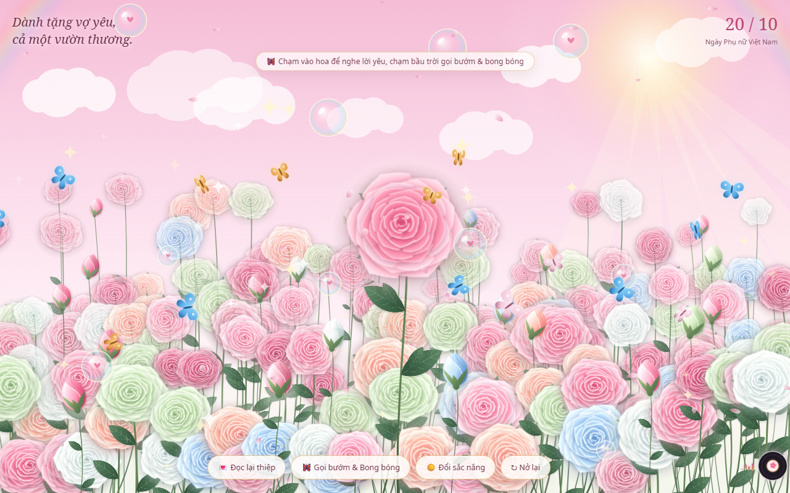

# 🌸 TangVk2010 · Khu Vườn Hoa Dành Tặng Vợ Yêu 20/10

> *"Một bông hoa có thể làm một ngày thêm đẹp. Còn em, làm cho cuộc sống của anh luôn ngập tràn sự dịu dàng và ấm áp mỗi ngày."*

Trang web thiệp hoa tương tác đặc biệt và lãng mạn, được thiết kế và tối ưu riêng để dành tặng người vợ thân yêu nhân ngày **Phụ nữ Việt Nam 20/10**.

🌐 **Trải nghiệm trực tiếp:** [https://tangvkyeu.baolab.io.vn](https://tangvkyeu.baolab.io.vn)  
*(Backup link: [https://flowers-20-10-flax.vercel.app](https://flowers-20-10-flax.vercel.app))*

<p align="center">
  
</p>

---

## ✨ Điểm Nổi Bật & Tính Năng

### 🌸 1. Khu Vườn Hồng Bung Nở Hoạt Ảnh (Canvas 2D Botany)
- Vẽ hoa và chuyển động dựa trên thuật toán vector thực vật học (`garden-botany.js`), mô phỏng chân thực từng lớp cánh hoa hồng bung nở từ giữa lan tỏa ra hai bên.
- Hoa đung đưa theo từng cơn gió thoảng, phủ giọt sương mai lấp lánh phản chiếu ánh sáng.

### ☀️ 2. Bầu Trời Ban Ngày & 3 Sắc Nắng Thơ Mộng
- **Sắc Nắng Hồng Sakura (Mặc định):** Bầu trời hồng phấn ngọt ngào ngập tràn nắng ấm ban mai.
- **Tia Nắng Sớm (God-Rays) & Cầu Vồng Đôi Pastel:** Luồng sáng mặt trời chiếu xuyên qua mây trắng bồng bềnh và vòm cầu vồng đôi rực rỡ dần khi hoa nở rộ.
- **Nút "☀️ Đổi sắc nắng":** Chuyển đổi linh hoạt giữa 3 sắc thái trời ban ngày: *Hồng Sakura* → *Nắng Sớm Pha Lê (Trời Xanh)* → *Nắng Hoàng Kim Mật Ong*.

### 🦋 3. Đàn Bướm 3D & Bong Bóng Pha Lê Trái Tim
- **Đàn bướm 3D đa sắc:** Đập cánh mềm mại lượn quanh các đóa hoa, tự động bay lượn hướng theo ngón tay chạm/di chuyển trên màn hình.
- **Bong bóng ôm trái tim (`♡`):** Những quả bong bóng xà phòng ánh sắc cầu vồng mang theo trái tim hồng bay bổng lên nền trời nắng.
- **Nút "🦋 Gọi bướm & Bong bóng":** Thả thêm từng đàn bướm và bong bóng bay lên chúc mừng.

### 💌 4. Bức Thư Tình & Popup Lời Chúc Chuẩn Stable
- Nội dung thư chúc mừng 20/10 chân thành, đong đầy yêu thương và lời hứa đồng hành cùng vợ vượt qua mọi sóng gió cuộc đời.
- Thiết kế popup mờ ảo (Glassmorphism), nền trong suốt nhẹ nhàng giữ trọn cảm xúc nguyên bản.
- Tự động hiển thị sau khi cả khu vườn bung nở rực rỡ; thanh nút chức năng chỉ hiện ra sau khi đóng thiệp lần đầu để không che khuất chữ.

### 💬 5. Hoa Biết Thì Thầm (Interactive Whispers)
- Chạm vào từng đóa hồng đang nở để lắng nghe những lời yêu thương ngẫu nhiên gửi tới vợ yêu (kèm hiệu ứng nảy nhẹ và hoa tỏa bụi sáng).

### 🎵 6. Đĩa Than Vinyl & Nhạc Nền Tự Động
- Trình phát nhạc đĩa than cổ điển nằm gọn gàng sát mép phải màn hình, cột sóng equalizer nhịp nhàng bên trái.
- Nhạc nền lãng mạn được cắt gọt mượt mà (bỏ qua 4 giây dạo đầu) và tự động phát ngay khi vào web hoặc chạm lần đầu.

### 📱 7. Tối Ưu Cho Mobile (Đặc biệt iPhone)
- Thiết kế chuẩn `100dvh`, thích ứng Dynamic Island và Safe Area Insets (`env(safe-area-inset-*)`) trên **iPhone 15 Pro Max** và mọi thiết bị di động.
- Cơ chế chống giật lag, giữ trọn 60fps mượt mà trên cả trình duyệt máy tính (Chrome, Safari, Edge) kể cả khi bật chế độ hạn chế chuyển động.

---

## 🗂️ Cấu Trúc Dự Án

```text
TangVk2010/
├── index.html            # Trang chủ chính thức (/): Vườn hoa nắng hồng, đàn bướm 3D, cầu vồng, thiệp tình yêu
├── v1.html               # Trang kỷ niệm (/v1): Phiên bản vườn hoa truyền thống ban đầu
├── garden.html           # Trang phụ trợ tương đương index.html (/garden)
├── beta.html             # Trang thử nghiệm tính năng mới (/beta)
├── garden-botany.js      # Thuật toán render hoa, cành lá và chuyển động sinh học trên Canvas
├── assets/
│   ├── audio/
│   │   └── background.mp3  # Nhạc nền lãng mạn (đã tối ưu & trim 4s đầu)
│   └── fonts/              # Bộ font Noto Serif / Noto Sans offline mượt mà
├── .ai/                  # Bộ nhớ ngữ cảnh và quy chuẩn phát triển AI (Project Context)
├── vercel.json           # Cấu hình routing & cleanUrls cho Vercel deployment
├── package.json          # Cấu hình package & scripts dự án
└── README.md             # Tài liệu giới thiệu dự án
```

---

## 🚀 Cài Đặt & Chạy Thử Nghiệm (Local Development)

Dự án sử dụng thuần **HTML5 / CSS3 / Vanilla JavaScript**, không yêu cầu build step phức tạp:

1. **Clone repository:**
   ```bash
   git clone https://github.com/giabao98/TangVk2010.git
   cd TangVk2010
   ```

2. **Chạy local web server:**
   - Sử dụng **Python**:
     ```bash
     python -m http.server 8080
     ```
   - Hoặc sử dụng **Node.js / npx serve**:
     ```bash
     npx serve .
     ```

3. Mở trình duyệt và truy cập: `http://localhost:8080`

---

## ☁️ Triển Khai (Deployment)

Dự án được cấu hình sẵn sàng cho **Vercel**:

```bash
# Deploy lên môi trường Production
npx vercel deploy --prod
```

---

## 💖 Dành Cho Vợ Yêu

> *"Hôm nay và cả những ngày sau, hãy luôn rạng rỡ và mỉm cười em nhé. Yêu vợ thật nhiều!"*  
> — **Chồng yêu của em ♡**
